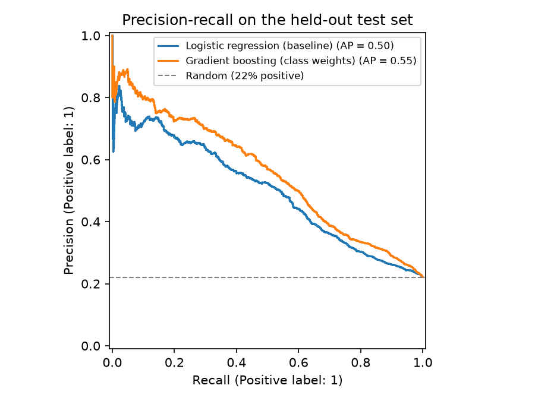
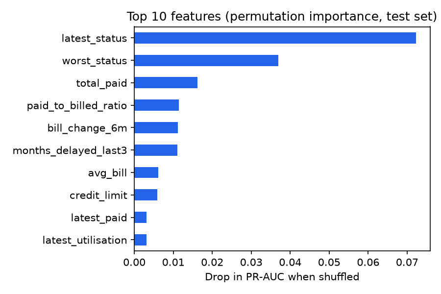

# Customer Payment Behaviour Classifier

[](https://github.com/shubham-italiya/payment-behaviour-classifier/actions/workflows/ci.yml)


Predicts which customers will **miss next month's payment**, using six months of statements, payments and
repayment history for 30,000 credit-card customers. Features are built in **SQL**; models are compared with
**scikit-learn** and **imbalanced-learn**; the decision threshold is tuned with cross-validation.

## Results

Held-out test set: 6,000 customers (22.1% paid late), scored once at the end.

| Model | F1 | Precision | Recall | PR-AUC | ROC-AUC |
|---|---|---|---|---|---|
| Baseline: logistic regression, threshold 0.50 | 0.405 | 0.646 | 0.295 | 0.499 | 0.742 |
| **Gradient boosting + class weights, tuned threshold 0.56** | **0.543** | 0.516 | **0.573** | **0.553** | **0.777** |

- **F1 up 34%** over the baseline, and the model **finds almost twice as many late payers** (recall 0.57 vs 0.30).
- **SMOTE did not help here.** With 5-fold cross-validation, class weights beat SMOTE for gradient boosting
  (PR-AUC 0.556 vs 0.528) and SMOTE made no difference for logistic regression (0.507 vs 0.508). Synthetic
  minority samples add noise for tree models; re-weighting keeps the real data.
- **The threshold matters as much as the model.** At the default 0.50 the baseline misses 70% of late payers;
  tuning the threshold for F1 on the training folds trades a little precision for much higher recall.
- **Recent behaviour dominates:** last month's repayment status is by far the strongest signal, followed by the
  worst status in six months and how much the customer actually paid.

<p>
  
  
</p>

Full numbers: [`reports/results.md`](reports/results.md) and [`reports/metrics.json`](reports/metrics.json).

## How it works

1. **Data into SQL tables.** The raw file has one wide row per customer. [`payclf.data`](src/payclf/data.py)
   reshapes it into three tables ([`sql/schema.sql`](sql/schema.sql)): `customers`, `statements` (one row per
   customer per month) and `outcomes`.
2. **Features in SQL.** [`sql/features.sql`](sql/features.sql) joins and aggregates the tables into 15 behaviour
   features per customer, for example:

   ```sql
   SUM(CASE WHEN s.repayment_status > 0 AND s.month_index <= 3 THEN 1 ELSE 0 END) AS months_delayed_last3,
   SUM(s.paid_amount) / NULLIF(SUM(CASE WHEN s.bill_amount > 0 THEN s.bill_amount END), 0) AS paid_to_billed_ratio
   ```
3. **Model selection.** Four candidates (logistic regression and gradient boosting, each with SMOTE or with
   class weights) are compared with stratified 5-fold cross-validation on the training set. The score is
   **PR-AUC**, which suits imbalanced data better than accuracy or ROC-AUC.
4. **Threshold tuning.** The best model is wrapped in `TunedThresholdClassifierCV`, which picks the threshold that
   maximises F1 using cross-validation on the training data only.
5. **One final test.** 20% of customers are held out from the start and used once, for the table above.

## Responsible modelling

Sex, age, marital status and education are in the database but are **not used as features**: predictions depend
only on payment behaviour. A fairness check of error rates across groups is a sensible next step (below).

## Run it

```bash
pip install -e ".[dev]"
make data    # downloads the dataset (~5 MB) and builds data/payments.db
make train   # about 30 seconds on a laptop; writes reports/
make test    # unit tests for the reshaping, the SQL features and the models
```

## Project structure

```
sql/schema.sql          tables: customers, statements, outcomes
sql/features.sql        feature engineering in SQL
src/payclf/data.py      download + reshape + load into SQLite
src/payclf/features.py  run the SQL, list of model features
src/payclf/model.py     candidate models, threshold tuning, evaluation
src/payclf/train.py     the experiment; writes reports/
tests/                  pytest suite (runs in CI on every push)
```

## Limitations and next steps

- The data comes from one Taiwanese bank in 2005; patterns elsewhere or today may differ.
- F1 treats a missed late payer and a false alarm as equally costly. With real business costs, the threshold
  should be chosen by expected cost instead.
- Next: probability calibration, a per-group fairness audit, and hyper-parameter search with nested CV.

## Data

Yeh, I.-C. (2009). *Default of Credit Card Clients* [Dataset]. UCI Machine Learning Repository.
https://doi.org/10.24432/C55S3H, licensed [CC BY 4.0](https://creativecommons.org/licenses/by/4.0/).
The data is downloaded by `make data` and is not stored in this repository.

## Background

This is a 2026 rebuild of a university group project (team of three, late 2024) on flagging late-paying
customers. The original code and data were lost, so I rebuilt it on my own with a public dataset. All numbers
on this page come from this rebuild.
